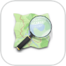
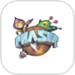
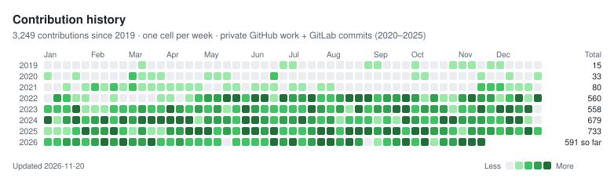

<picture>
  <source media="(prefers-color-scheme: dark)" srcset="./assets/header-dark.svg" />
  
</picture>

I build the backend side of GPS fleet tracking: services that pull telemetry from vendor platforms, store it in PostgreSQL + PostGIS, and turn it into routes, reports and regulatory feeds. Mostly Python (Django, FastAPI), and Rust where it has to be fast.

I also build LLM tooling, like a Text-to-SQL pipeline over a RAG system whose database roles only let the model read what it should. After hours I make pixel-art games in Phaser 4 and compose their music.

Open to freelance work and collaborations: [ederastonmartin@hotmail.com](mailto:ederastonmartin@hotmail.com)

## What I build

| Area | What it looks like in practice |
|---|---|
| 🛰️ **Vehicle tracking backends** | Services that ingest, validate and store GPS telemetry at scale, with geospatial queries (routes, geofences, positions) on PostgreSQL + PostGIS. |
| 📡 **Telemetry relay for compliance** | A GPS server that re-transmits vehicle positions to third-party / regulatory endpoints reliably and with traceability. |
| 🧾 **Business & regulatory automation** | Django modules that automate invoicing and volumetric-control records (receipts, deliveries, compliance reports). |
| 🤖 **LLM data access** | A Text-to-SQL pipeline over a RAG system (LangGraph + OpenAI/DeepSeek), with **hardened PostgreSQL roles** so the model can only read what it's allowed to. |
| ☁️ **Deployment & ops** | Dockerized services on Linux (CentOS) servers in Google Cloud Platform, with Redis for caching and queues. |

Details are kept generic on purpose. Happy to walk through architecture and trade-offs in a call.

## Platforms I've integrated

<table>
  <tr>
    <th>Area</th>
    <th width="240">Platforms</th>
    <th>What I did</th>
  </tr>
  <tr>
    <td>🛰️ <b>GPS telematics</b></td>
    <td>
      <a href="https://wialon.com">&nbsp;Wialon</a> 
      <a href="https://www.mapon.com">&nbsp;Mapon</a> 
      <a href="https://www.webfleet.com">&nbsp;Webfleet</a> 
      <a href="https://www.protrack365.com">&nbsp;ProTrack</a>
    </td>
    <td>Synced units, positions, geofences and drivers into one console; reports and mileage.</td>
  </tr>
  <tr>
    <td>📹 <b>Video telematics</b></td>
    <td>
      <a href="https://www.streamax.com">&nbsp;Streamax</a> 
      <a href="https://www.hikvision.com">&nbsp;Hikvision</a> 
      <a href="https://www.jimiiot.com">&nbsp;JimiIoT</a>
    </td>
    <td>Live and recorded MDVR / camera video in the browser; alarm events relayed in real time by Node and Rust services.</td>
  </tr>
  <tr>
    <td>🗺️ <b>Maps &amp; geo</b></td>
    <td>
      <a href="https://mapsplatform.google.com">&nbsp;Google&nbsp;Maps</a> 
      <a href="https://www.openstreetmap.org">&nbsp;OpenStreetMap</a> 
      <a href="https://leafletjs.com">&nbsp;Leaflet</a>
    </td>
    <td>Geofences, route traces and geocoding (<a href="https://nominatim.org">Nominatim</a>) on top of PostGIS.</td>
  </tr>
  <tr>
    <td>🖨️ <b>Print fleet monitoring</b></td>
    <td>
      <a href="https://www.kpax-manage.com">&nbsp;KPAX</a>
    </td>
    <td>Printer status, toner levels and consumption history in the console, through a Rust (actix&#8209;web) gateway with OAuth2 token caching.</td>
  </tr>
  <tr>
    <td>🧾 <b>ERP &amp; e&#8209;invoicing</b></td>
    <td>
      <a href="https://www.contpaqi.com">&nbsp;CONTPAQi</a>
    </td>
    <td>Invoice stamping and cancellation through CONTPAQi.</td>
  </tr>
  <tr>
    <td>💬 <b>Messaging &amp; automation</b></td>
    <td>
      <a href="https://developers.facebook.com/documentation/business-messaging/whatsapp/about-the-platform">&nbsp;WhatsApp&nbsp;Cloud&nbsp;API</a> 
      <a href="https://n8n.io">&nbsp;n8n</a> 
      <a href="https://firebase.google.com/docs/cloud-messaging">&nbsp;Firebase&nbsp;Cloud&nbsp;Messaging</a>
    </td>
    <td>Invoices and payment receipts over WhatsApp, push notifications.</td>
  </tr>
  <tr>
    <td>🤖 <b>AI APIs</b></td>
    <td>
      <a href="https://openai.com/api/">&nbsp;OpenAI</a> 
      <a href="https://api-docs.deepseek.com">&nbsp;DeepSeek</a> 
      <a href="https://ai.google.dev/gemini-api">&nbsp;Gemini</a> 
      <a href="https://www.voyageai.com">&nbsp;Voyage&nbsp;AI</a>
    </td>
    <td>Text-to-SQL, document OCR from photos (vision models), embeddings for RAG.</td>
  </tr>
</table>

<!--
TODO: un-comment this section once the public demo repos exist (avoid 404 links).

---

## 🚀 Featured public projects

| Project | Stack | Description |
|---|---|---|
| [fastapi-postgis-tracker](https://github.com/Darkerc/fastapi-postgis-tracker) | FastAPI · PostGIS · Docker | Demo GPS tracking API with geofencing on synthetic data. |
| [rust-telemetry-relay](https://github.com/Darkerc/rust-telemetry-relay) | Rust · Tokio | Small, fast telemetry relay written in Rust. |
| [phaser-skins-demo](https://github.com/Darkerc/phaser-skins-demo) | Phaser 4 · JS | Character-skin system & state management demo with pixel art. |
| [Nuxt_MEVN_Scaffolding](https://github.com/Darkerc/Nuxt_MEVN_Scaffolding) | Nuxt · Express · MongoDB | Early full-stack MEVN scaffolding (archived learning project). |
-->

## Tech stack

<table>
  <tr>
    <td><b>Core</b></td>
    <td nowrap>
      <a href="https://www.python.org">&nbsp;Python</a>&emsp;
      <a href="https://www.rust-lang.org">&nbsp;Rust</a>&emsp;
      <a href="https://developer.mozilla.org/en-US/docs/Web/JavaScript">&nbsp;JavaScript</a> 
      <a href="https://www.djangoproject.com">&nbsp;Django</a>&emsp;
      <a href="https://fastapi.tiangolo.com">&nbsp;FastAPI</a>&emsp;
      <a href="https://www.sqlalchemy.org">&nbsp;SQLAlchemy</a>&emsp;
      <a href="https://www.langchain.com/langgraph">&nbsp;LangGraph</a> 
      <a href="https://www.postgresql.org">&nbsp;PostgreSQL</a>&emsp;
      <a href="https://postgis.net">&nbsp;PostGIS</a>&emsp;
      <a href="https://redis.io">&nbsp;Redis</a> 
      <a href="https://www.docker.com">&nbsp;Docker</a>&emsp;
      <a href="https://www.kernel.org">&nbsp;Linux</a>&emsp;
      <a href="https://www.centos.org">&nbsp;CentOS</a>&emsp;
      <a href="https://cloud.google.com">&nbsp;Google&nbsp;Cloud</a>
    </td>
  </tr>
  <tr>
    <td><b>Also comfortable with</b></td>
    <td nowrap>
      <a href="https://vuejs.org">&nbsp;Vue</a>&emsp;
      <a href="https://nuxt.com">&nbsp;Nuxt</a>&emsp;
      <a href="https://nodejs.org">&nbsp;Node.js</a> 
      <a href="https://www.php.net">&nbsp;PHP</a>&emsp;
      <a href="https://developer.mozilla.org/en-US/docs/Web/HTML">&nbsp;HTML</a>&emsp;
      <a href="https://developer.mozilla.org/en-US/docs/Web/CSS">&nbsp;CSS</a> 
      <a href="https://git-scm.com">&nbsp;Git</a>&emsp;
      <a href="https://github.com/features/actions">&nbsp;GitHub&nbsp;Actions</a>&emsp;
      <a href="https://www.gnu.org/software/bash/">&nbsp;Bash</a>&emsp;
      <a href="https://www.postman.com">&nbsp;Postman</a>
    </td>
  </tr>
  <tr>
    <td><b>Exploring</b></td>
    <td nowrap>
      <a href="https://phaser.io">&nbsp;Phaser&nbsp;4</a>&emsp;
      <a href="https://portswigger.net/burp">&nbsp;Burp&nbsp;Suite</a>
    </td>
  </tr>
</table>

## Activity

  <picture>
    <source media="(prefers-color-scheme: dark)" srcset="./profile/streak-dark.svg" />
    
  </picture>

Most of my professional work lives in private repositories: on GitHub today, and on GitLab from 2020 to 2025. The GitLab commits are mirrored here as timestamps only (no code), so this chart is the best public trace of both.

<picture>
  <source media="(prefers-color-scheme: dark)" srcset="./profile/history-dark.svg" />
  
</picture>

<!--
TODO: add the Top languages card back once public repos reflect the real stack
(today public repos are ~70% PHP from school projects).
<picture>
  <source media="(prefers-color-scheme: dark)" srcset="./profile/top-langs-dark.svg" />
  
</picture>
-->

## Now

- **Learning:** Rust (async, systems tooling) and web security, working toward Burp Suite Certified Practitioner.
- **Building:** a pixel-art game in Phaser 4 (character skins, state management), with my own music and SFX.
- **Tinkering:** hardware security with a Flipper Zero.
